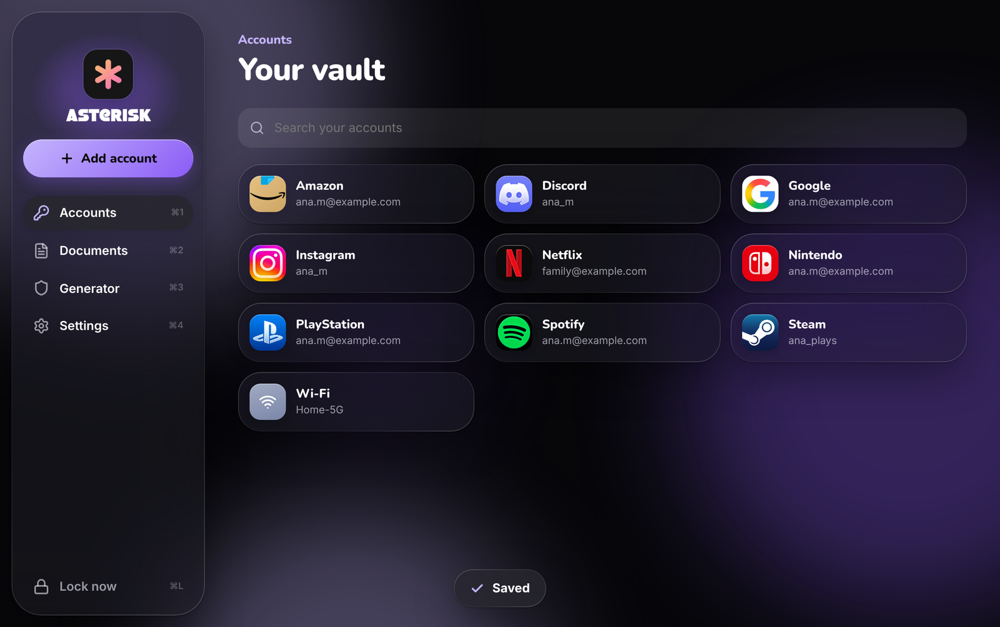
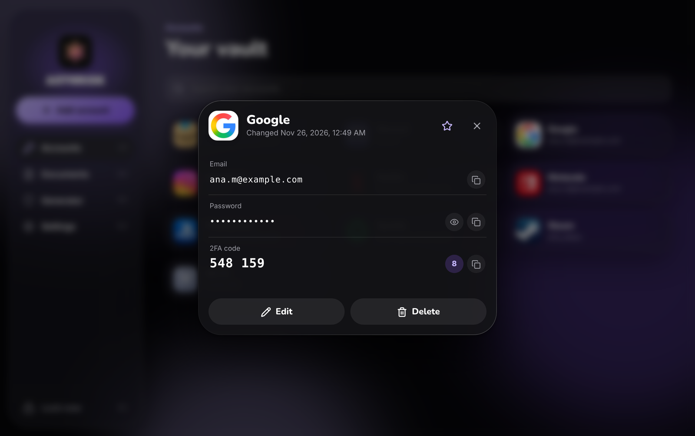
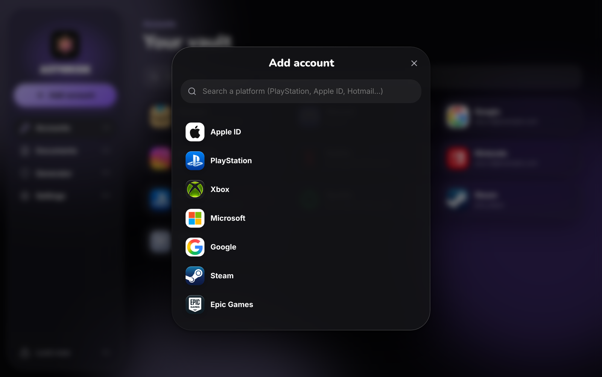
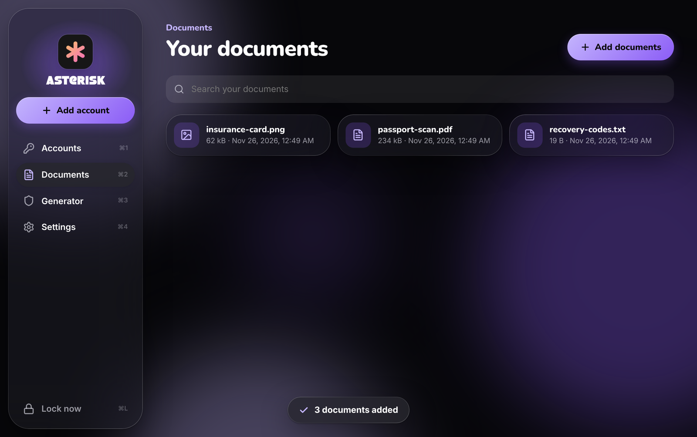
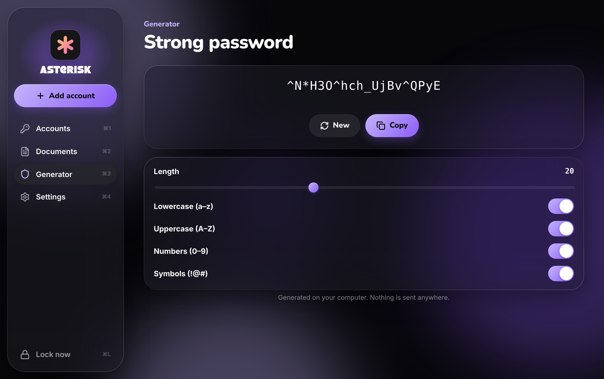
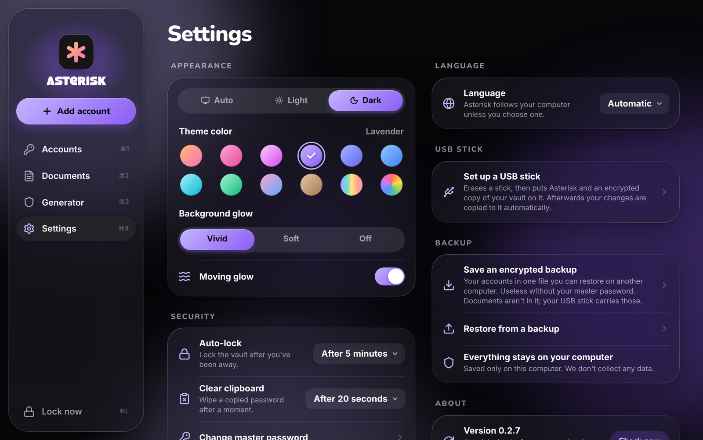
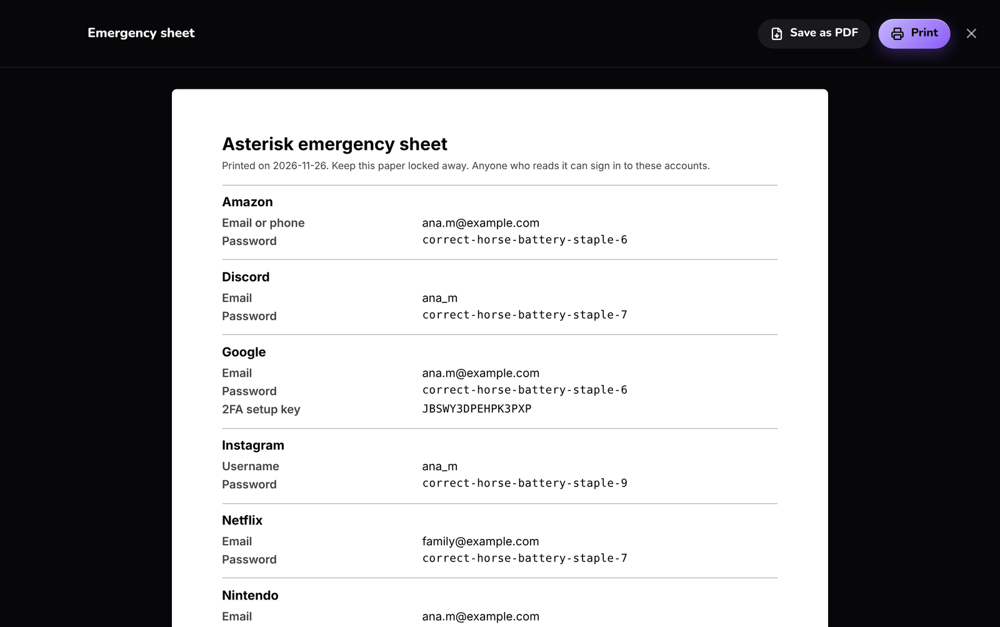
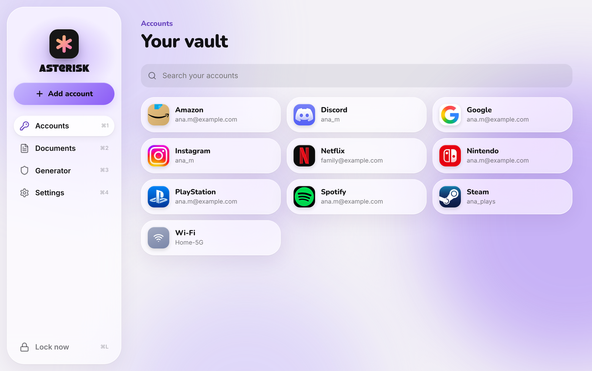

# Asterisk

A private, offline password manager for Mac and Windows. Your accounts, 2FA codes and important documents live in an encrypted vault on your own computer, and optionally on a USB stick you set up from the app. Nothing is stored online, and nothing about you is ever sent anywhere.

Made by beepinho. Free.

## Download

Go to **[Releases](../../releases/latest)** and pick your installer:

- **Mac:** `Asterisk_x.x.x_universal.dmg` — open it and drag Asterisk to Applications. Works on macOS 10.15 Catalina and newer, Intel and Apple Silicon.
- **Windows:** `Asterisk_x.x.x_x64-setup.exe` — open it.

### Why your computer warns you the first time

Asterisk is a free app made by one person, so it isn't signed with a paid Apple or Microsoft certificate. Both systems warn about apps like that. You only see it the first time you open it.

- **Mac:** right-click Asterisk in Applications and choose **Open**, then **Open** again. On newer Macs you may need **System Settings → Privacy & Security → Open Anyway** instead.
- **Windows:** if it says *"Windows protected your PC"*, click **More info**, then **Run anyway**. If Windows Defender blocks it, that's a false alarm for the same reason: open **Windows Security → Protection history**, choose the Asterisk entry, then **Actions → Allow on device**.

Asterisk checks for updates when it opens and installs them with one click. Every update is signed, so the app only accepts real ones.

## What it does

| | |
|---|---|
|  |  |
|  |  |

- **Accounts** — sign-ins, passwords and any fields you want, with a search box and a strong password generator.
- **2FA codes** — paste a setup key and Asterisk shows the 6-digit codes, offline.
- **Documents** — keep recovery codes, scans, PDFs and photos (up to 20 MB each) in the same encrypted vault.
- **USB stick** — Settings can erase a stick and install a self-contained copy of Asterisk plus your vault and documents on it. It stays up to date whenever the stick is plugged in, and the stick's app works on any computer with a browser, with no internet and nothing written to that computer.
- **Emergency sheet** — every account on paper or as a PDF, for the day no screen works. Asks for your master password first.
- **Backups** — an encrypted backup file you can restore on another computer with your master password.
- **Languages** — English, French, Portuguese, German and Spanish, following your computer.

## How it's protected

- The vault is encrypted with **AES-256-GCM**. The key is never stored; it is derived from your master password with **Argon2id** (or PBKDF2 with 2,000,000 rounds on macOS Catalina, which can't run Argon2 fast enough).
- The master password is the only key. **It cannot be recovered or reset.** Write it down and keep it somewhere safe.
- The app only connects to the internet to check for updates and account icons, both signed with the same key. Switch off *Check for updates automatically* in Settings and it never connects at all. The USB stick app never connects.
- Wrong master passwords make the next try wait longer; the clipboard is wiped shortly after you copy a password; the vault locks itself when you're away.

Nothing is completely safe. Asterisk can't protect you from a computer that already has a virus, from a weak or shared master password, or from an emergency sheet left lying around.

Light theme, and ten colour themes to choose from:

## Privacy

Asterisk collects no data. There is no account, no server and no analytics. The only requests it makes are the update and icon checks to GitHub, which send nothing about you beyond the request itself.

## Support

Questions and problems: **beepinhobusiness@hotmail.com**

If Asterisk is useful to you: [buymeacoffee.com/beepinho](https://buymeacoffee.com/beepinho)

## Terms of use

Asterisk is provided as is, free of charge, without warranty of any kind. You are responsible for your master password, your backups and your printed sheets. beepinho is not liable for any loss of passwords, documents or data, or for any damage arising from the use of Asterisk. By using it you accept this.

Trademarks and logos shown as account icons belong to their respective owners and are used only to identify your own accounts.

---

Made by beepinho · © beepinho. All rights reserved.
